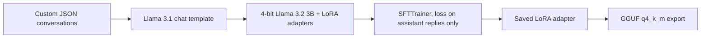

# Generative AI and LLM Fine-Tuning

**Llama 3.2 3B Instruct · Unsloth · QLoRA (4-bit + LoRA) · Hugging Face TRL · GGUF export**

Fine-tunes Llama 3.2 3B Instruct on a custom conversational dataset in the Llama 3.1 chat format, trains only on the assistant's replies, and exports the result to GGUF so it can run locally with llama.cpp-compatible tools.

| Notebook | What it covers |
| --- | --- |
| [01_llama_lora_finetuning.ipynb](01_llama_lora_finetuning.ipynb) | Data formatting, 4-bit loading, LoRA training with TRL's `SFTTrainer`, inference and GGUF export. |

## How it works

1. **Data preparation.** Loads a custom JSON file of multi-turn conversations, converts it to Hugging Face's `role`/`content` format, and renders each conversation with the Llama 3.1 chat template.
2. **Model loading.** Loads `unsloth/Llama-3.2-3B-Instruct` in 4-bit to keep GPU memory low.
3. **LoRA adapters.** Rank 16, alpha 16, applied to all attention and MLP projection layers (`q`, `k`, `v`, `o`, `gate`, `up`, `down`), with Unsloth gradient checkpointing.
4. **Training.** TRL `SFTTrainer` with batch size 2, gradient accumulation 4 (effective batch 8), learning rate 2e-4 with linear decay, 8-bit AdamW, and bf16 or fp16 chosen automatically. Loss is computed on assistant replies only, so the model learns to answer rather than to repeat prompts.
5. **Inference and export.** Reloads the adapter for fast inference, generates replies through the same chat template, saves the adapter, and exports a 4-bit `q4_k_m` GGUF model.

## Running it

Open the notebook in Google Colab or on a machine with a CUDA GPU, run the install cell, and set the path to your JSON dataset in the data cells. The notebook trains for 60 steps by default; set `num_train_epochs = 1` instead of `max_steps` for a full pass over the data.

## Credits

The training setup follows the [Unsloth conversational fine-tuning workflow](https://github.com/unslothai/notebooks). Model and dataset licences apply separately.

[Browse all AI, ML and automation topics](https://github.com/captof-omuamua/Colab-AI-ML-Projects).
